<p align="center">
  
</p>

<h1 align="center">Botloft</h1>

<p align="center">
  <b>Your AI agents, always on, working together.</b><br>
  A crew of AI agents on your own computer. They hand work to each other, keep going after you
  close the window and ask before they act.
</p>

<p align="center">
  <a href="https://github.com/httpsphl/botloft/releases/latest"></a>
  <a href="https://github.com/httpsphl/botloft/actions/workflows/ci.yml"></a>
  
  <a href="LICENSE"></a>
</p>

<p align="center">
  <a href="https://botloft.comitium.com.br"><b>Website</b></a>
  &nbsp;·&nbsp;
  <a href="#download"><b>Download</b></a>
  &nbsp;·&nbsp;
  <a href="#highlights">Highlights</a>
  &nbsp;·&nbsp;
  <a href="#why-botloft">Why Botloft</a>
  &nbsp;·&nbsp;
  <a href="#everything-it-does">Everything it does</a>
  &nbsp;·&nbsp;
  <a href="#faq">FAQ</a>
</p>

<p align="center">
  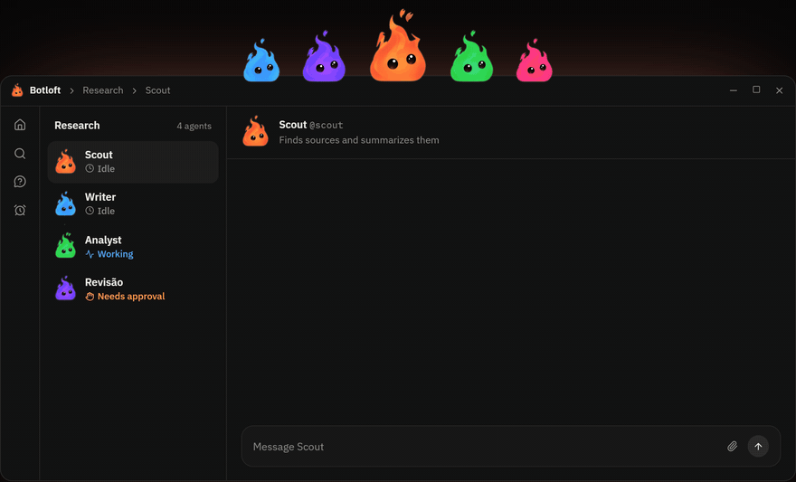
</p>

Botloft keeps a crew of agents running on your computer, each on the AI coding engine you choose:
[Claude Code](https://code.claude.com), or, as experimental options,
[Antigravity](https://antigravity.google) and [Codex](https://developers.openai.com/codex). Each
agent has its own folder, memory and conversation. You talk to each one like in a chat app, they
pass work to each other, and you decide what they may do.

## Download

<table>
  <tr>
    <th width="33%">Windows 10 and 11</th>
    <th width="33%">macOS (Apple Silicon)</th>
    <th width="33%">Linux</th>
  </tr>
  <tr>
    <td align="center"><a href="https://botloft.comitium.com.br/download/windows"><b>Installer</b></a> · 20 MB</td>
    <td align="center"><a href="https://botloft.comitium.com.br/download/macos"><b>.dmg</b></a> · 13 MB · preview</td>
    <td align="center"><a href="https://botloft.comitium.com.br/download/linux-deb"><b>.deb</b></a> · <a href="https://botloft.comitium.com.br/download/linux-appimage"><b>AppImage</b></a> · preview</td>
  </tr>
</table>

You need [Claude Code](https://code.claude.com/docs/en/setup) installed and signed in once with your
own account: your agents run on your plan. Open Botloft and it sets itself up, with nothing to
configure, and it updates itself. Every file is also on the
[releases page](https://github.com/httpsphl/botloft/releases/latest); [Get started](#get-started)
has the details for each system.

## Highlights

<table>
  <tr>
    <td colspan="2" align="center">
      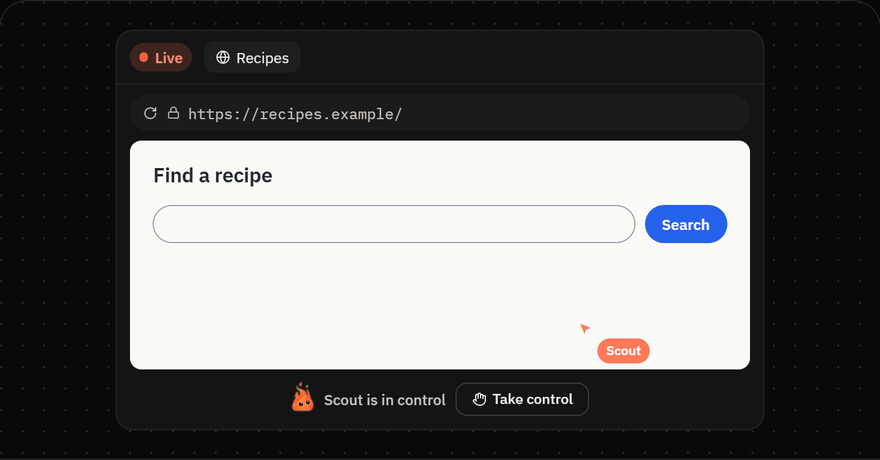
      <br><b>Watch them work.</b> See every page an agent opens, live, and take control to sign in for it.
    </td>
  </tr>
  <tr>
    <td width="50%" valign="top">
      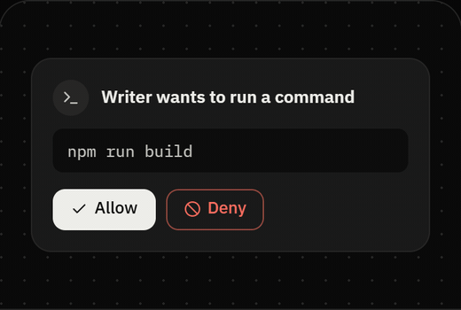
      <br><b>You decide what they may do.</b> A command, a file edit, a new website: a card asks you
      first, unless you told that agent it may.
    </td>
    <td width="50%" valign="top">
      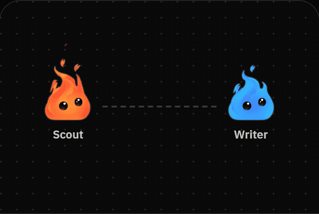
      <br><b>They hand work to each other.</b> Messages and tasks between agents are saved before they
      go and retried until they arrive.
    </td>
  </tr>
  <tr>
    <td width="50%" valign="top">
      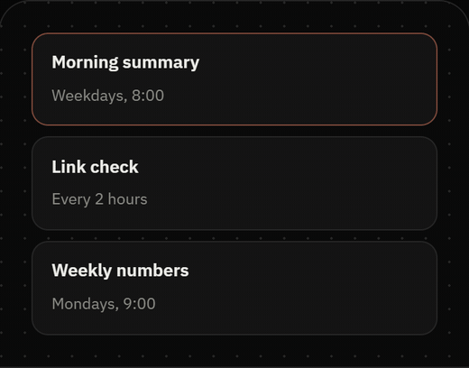
      <br><b>Routines on a schedule.</b> Weekday mornings, every two hours or any schedule, or a
      shortcut you run with one click.
    </td>
    <td width="50%" valign="top">
      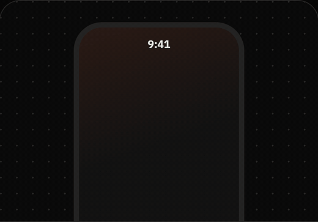
      <br><b>From your phone.</b> Approve, answer and chat from anywhere, sealed end to end between
      the phone and your computer.
    </td>
  </tr>
  <tr>
    <td colspan="2" align="center">
      
      <br><b>The Maker builds for you.</b> Ask for crews, agents and routines in your own words. You
      see the whole plan before anything is made, and Undo takes it back.
    </td>
  </tr>
  <tr>
    <td colspan="2" align="center">
      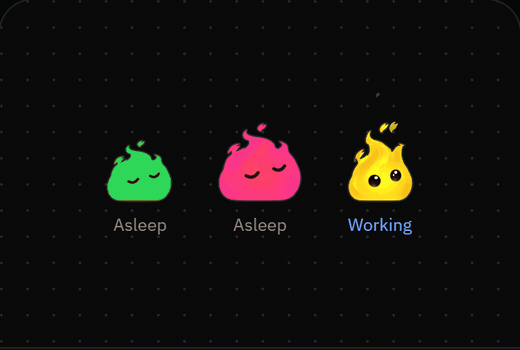
      <br><b>Always on, never in the way.</b> Agents keep working after you close Botloft. Idle ones
      sleep, using no memory, and wake with the same conversation.
    </td>
  </tr>
</table>

## Why Botloft

- **Light.** A 20 MB installer on Windows (13 MB on macOS), built with Rust and Tauri: one small
  program in the background, the app and your engine.
- **Always on, for real.** The agents live in a background service of your user, not in the window.
  Close Botloft or restart the computer and they pick up where they left off.
- **Yours.** Agents, chats and files stay on your disk, and there is no telemetry. The account is
  optional, and the copies it keeps are sealed on your computer before they leave.
- **No middleman.** Agents run on the Claude Code you already use, on your own plan: no API key to
  manage, and no service of ours between them and the engine. The tools you connected on claude.ai
  work as they are.
- **Crews with walls.** Each crew is a space of its own. Its agents talk to each other, and reach
  another crew only when you allow it.
- **You stay in charge.** Commands, file edits and new websites ask first, unless you said they
  may. Keys go in a hidden field and never into the chat.
- **Windows first.** Made and used every day on Windows, with your desktop apps, the island at the
  top of the screen and an installer that needs no administrator. Linux and macOS come as a preview.
- **Free, with its code public.** Use it for anything, at home or at work (see [License](#license)).

## Everything it does

Open an area to see all of it. Areas marked (Windows) work on Windows only for now.

<details>
<summary><b>Crews, agents and the Maker</b></summary>

- **Start a crew from a goal.** Say what the crew is for. Its Chief plans the work and suggests the
  agents it needs; you create each one with a click, or say why not.
- **Pick ready-made agents.** The Agent agency has dozens of agents ready for a job, like a
  developer, a designer, a writer, a researcher or customer support. Add one to a crew with a click
  and change anything about it afterwards. The Chief uses the same list when it suggests an agent.
- **Let the Maker build for you.** The Maker, a white flame with a wand, builds crews, agents and
  routines from what you ask. It shows the whole plan as a card you change before anything is made,
  and Undo takes it back. Bring your Claude Code history or your claude.ai export so it knows your
  projects: you choose what goes and read the whole summary first, with keys, e-mails and numbers
  swapped out.
- **Let the Maker change what you have.** Ask it to make a writer's posts shorter, add an agent to
  a crew or turn a routine off: the card shows each change as before and after. Archiving an agent
  or deleting a routine always asks, and Undo puts everything back.
- **Instructions for all your agents.** Write once what every agent should follow, like the
  language to answer in or how to name files, in Settings > Instructions for all. Agents get it
  the next time they are free, without losing their conversation.
- **Choose per agent.** Which engine and model it uses, how hard it thinks and how much it asks
  before acting. Its details read like a profile: role, instructions, folder and what it may do
  without asking.
- **See the plan first.** Turn on "Show the plan before long tasks" for an agent and it shows its
  steps before long work. It starts by itself unless you change or cancel it.
- **See inside an agent.** The overview, beside the chat when the window has room, shows what fills
  its conversation, what it left running in the background (and a way to stop it), what changed in
  its git folders and its pull requests' checks.

</details>

<details>
<summary><b>Chat</b></summary>

- **Chat with every agent.** Replies stream in as they are written. Send images and files, or drop
  them on the chat. Search every chat with Ctrl+K.
- **Stop an agent.** While a Claude Code agent works, a Stop button takes the place of Send. The
  turn ends where it was, and a request still waiting for you is denied.
- **Approve or deny.** When an agent wants to run a command, edit a file or open a website, a card
  asks you first, unless you told that agent it may. Each file edit shows how many lines it added
  and removed, and opens to its diff.
- **Answer their questions.** An agent that needs your decision asks in its chat and in the
  Questions box, and goes on with what it can, even in a routine at night. When a reply ends with a
  question, a 👍 or 👎 on it answers at once.
- **See what they made.** Sounds, videos and pictures an agent made play and open right in its
  chat. The files panel says what each file is, with thumbnails for pictures.
- **Keep the chats as long as you want.** For good, a year, 90 or 30 days (Settings > General >
  History).

</details>

<details>
<summary><b>Working together</b></summary>

- **Messages and tasks between agents.** Every message is saved before it is sent and retried until
  it arrives, or marked as failed so you can retry it.
- **Walls between crews.** An agent reaches another crew only when you allow it: once, for that
  agent, or for the whole crew.
- **One conversation per agent.** Your messages, other agents' messages and Botloft's notices reach
  it in order.

</details>

<details>
<summary><b>Browser, desktop and your Chrome</b></summary>

- **The agent's own browser, live.** Watch every page an agent opens and take control to sign in for
  it. Sites that refuse to sign in there, like Google, take one click more: sign in in a real window
  of the agent's browser, close it, and the agent keeps the login.
- **Sign in to a site once.** In Settings > Logins, sign in to a site in a Botloft window and choose
  which agents use that login. Nothing is read from your own browser.
- **Give your own Chrome to an agent.** With the Claude in Chrome extension, an agent on Claude Code
  can use your Chrome and its logins, only after a screen that spells out the risks. Settings >
  Permissions > Chrome shows who has it and who acts in it right now, with Stop.
- **Screens.** Watch the pages an agent designs take shape while it writes them, and open the files
  it made.
- **Your desktop apps (Windows).** An agent can read and use the apps open on your computer, like a
  spreadsheet or an old program with no website, but only those you allow. Seeing an app and using
  it are separate permissions, you watch it live, and Ctrl+Alt+Esc stops every agent on your
  desktop. Botloft itself, terminals, password managers and password fields are never shared.

</details>

<details>
<summary><b>Tools, skills and keys</b></summary>

- **Your claude.ai tools.** The tools you connected on claude.ai, like Google Calendar, Gmail, Drive
  or Notion, work in your agents with the login you made there. Choose which agents use each in
  Settings > Tools; an agent that needs one asks for it in the chat.
- **Tools of your own.** Add any MCP server, like a LinkedIn reader or your company's system. Agents
  still ask you before using it.
- **Your skills.** Settings > Skills lists the skills of your Claude Code and of claude.ai, says what
  each one runs before you give it, and has a switch for each agent.
- **Keys stay out of the chat.** When an agent needs a token or password for another service, it
  asks for it by name; you type it in a hidden field and the agent gets it as an environment
  variable.

</details>

<details>
<summary><b>Routines</b></summary>

- **On a schedule.** Weekday mornings, every two hours or any cron schedule, with missed runs and
  overlaps handled.
- **On a signal.** A routine can wait for another agent to say its part is done.
- **As a shortcut.** Run one with a click from the home, the chat, the island or your phone.

</details>

<details>
<summary><b>Always on</b></summary>

- **They keep going.** Agents keep working after you close Botloft. They start when you sign in,
  come back soon after a crash and keep the computer awake while they work.
- **Past the usage limit.** A turn the plan's limit cut short carries on by itself when the limit
  resets, from where it stopped. With paid extra usage on your Claude account, agents keep working.
- **No stuck turns.** A turn that shows nothing for half an hour is stopped, and the agent is
  restarted if that does not work.
- **They sleep when idle.** Agents that sit idle for a while sleep, so they use no memory, and wake
  with the same conversation when work comes. On a computer with little memory, you can also cap how
  many run at once.
- **Botloft near the clock.** It waits there and tells you when an agent needs you.
- **Your plan's usage.** See how much of it is left, from your account menu or the island.
- **The island (Windows).** A small island at the top of the screen shows who works and comes down
  when an agent needs you, so you answer without opening Botloft. Hold the right Ctrl alone to call
  it any time, for a quick request, your shortcuts or a chat.

</details>

<details>
<summary><b>Phone</b></summary>

- **Connect a phone.** Choose "Connect a phone" in Settings > Account and phone and scan the code
  with your phone's camera: Botloft opens there as a web page you can add to the Home Screen.
- **From anywhere.** Approve requests, answer questions, chat with your agents, send them photos and
  files and run your shortcuts, with a notice when one needs you.
- **Sealed end to end.** What passes between the phone and your computer goes through the server,
  which cannot read it. Anyone holding the phone unlocked can do the same, so you can lock the page
  with a PIN. Checked on Android, not yet on iPhone.

</details>

<details>
<summary><b>Backup and the cloud copy</b></summary>

- **A sealed backup file**, saved wherever you want.
- **A light copy in the cloud.** Sign in with your e-mail (no password) to keep your crews, the
  agents' memory and the routines in the cloud and restore them on another computer. The server
  cannot read it.
- **Automatic copies (Windows).** Every day or week, only when something changed.

</details>

Botloft speaks English, Portuguese (Brazil) and Spanish, follows your light or dark theme and
updates itself.

## Screenshots

<picture>
  <source media="(prefers-color-scheme: dark)" srcset="docs/assets/hero-dark.png">
  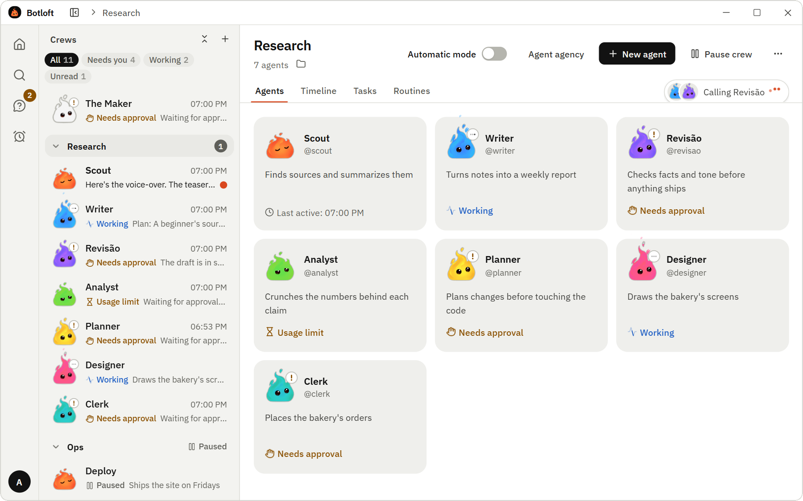
</picture>

<table>
  <tr>
    <td width="50%">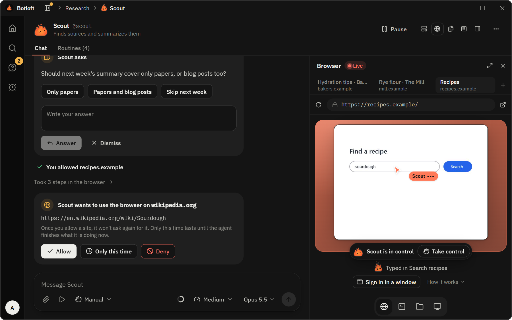<br><sub><b>Chat and live browser.</b> Scout asks before using a new site, and you watch it browse.</sub></td>
    <td width="50%">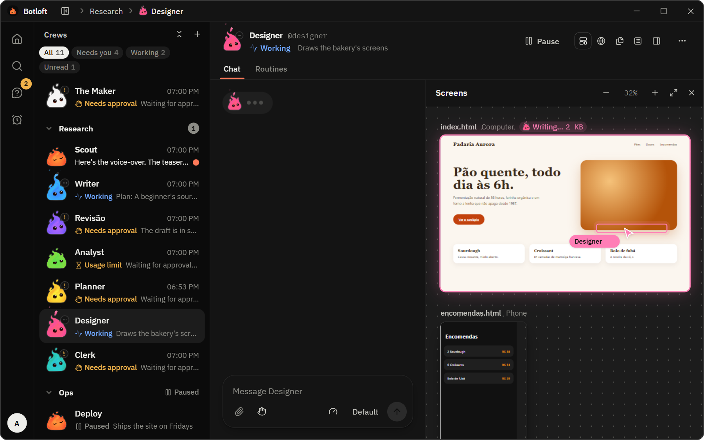<br><sub><b>Screens.</b> Designer's pages take shape while it writes them.</sub></td>
  </tr>
  <tr>
    <td width="50%">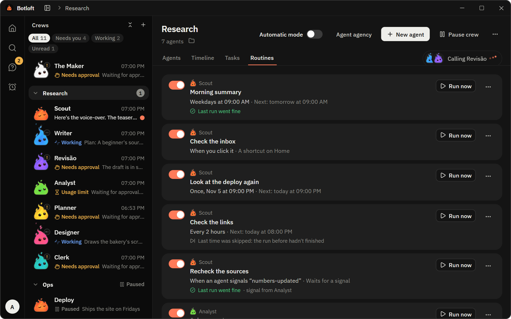<br><sub><b>Routines.</b> Work that runs on a schedule, with the last result at a glance.</sub></td>
    <td width="50%">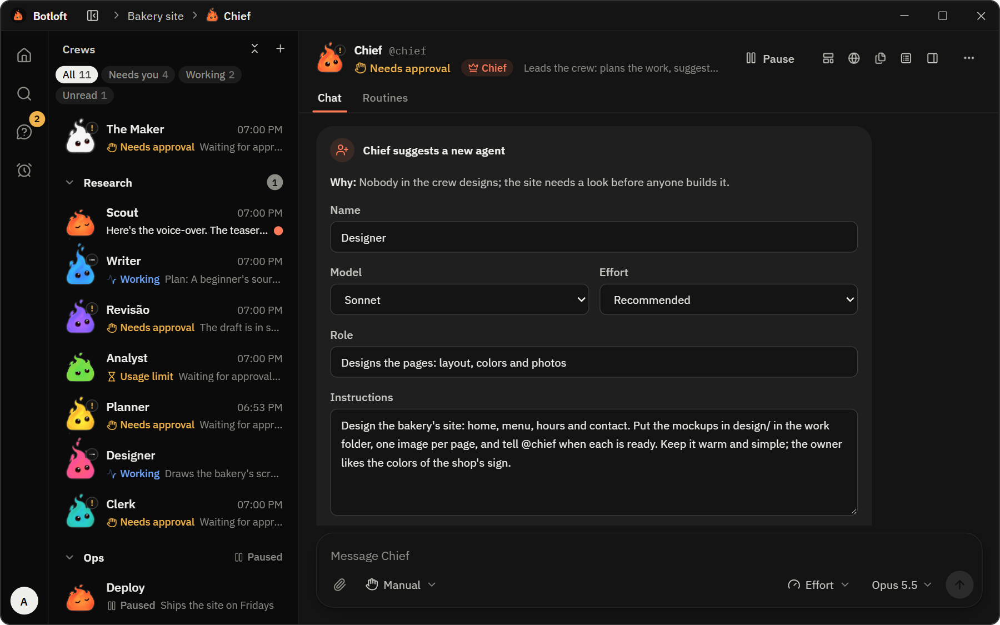<br><sub><b>A Chief for each crew.</b> It suggests the agents the work needs.</sub></td>
  </tr>
</table>

The screenshots and animations show sample crews, not real data.

## Engines

Claude Code is the full experience. Antigravity and Codex are experimental and off until you turn
on "Let me choose Antigravity and Codex" in Settings (or list them in Botloft's `config.toml`,
`experimental_agents = ["agy"]`, `["codex"]` or both); then a new agent can be made on them, and
Settings has "New agents run on".

Claude Code and Antigravity compare like this:

| | Claude Code | Antigravity (experimental) |
|---|---|---|
| Chat, crew messages, tasks, routines, the live browser | yes | chat, crew messages and tasks; the rest is not checked yet |
| Asks you before acting | yes: each tool, with "always allow" | no: it cannot ask. It works with files in its own folders; commands you list per agent (or "full access") |
| Images | yes | yes, by file |
| Model | your plan's default, or one you pick | its own list; the effort is part of the name |
| Usage meter and "Compact" | yes | an estimate of the conversation size; no compaction |
| Isolation between crews | yes | folders are fenced for its file tools, not for commands you allow |

A Codex agent asks you before it changes a file or runs a command, like Claude Code, and shows the
exact size of its conversation and the use of its plan; it can still read any file. It has its own
model list and effort picker, and understands images. See [spec section 30](docs/spec.md) for what
was checked.

## Get started

1. Install [Claude Code](https://code.claude.com/docs/en/setup) and sign in once with your own
   account. (Antigravity and Codex work the same way, with their own accounts; see
   [Engines](#engines).)
2. Download Botloft for your computer, from the [Download](#download) links or the
   [latest release](https://github.com/httpsphl/botloft/releases/latest):
   - **Windows 10 or 11 (64-bit):** `Botloft_<version>_x64-setup.exe`. It installs for your Windows
     user only, with no administrator prompt. The installer is not code-signed yet, so Windows
     SmartScreen may ask you to confirm ("More info", then "Run anyway").
   - **Linux (64-bit, preview):** `Botloft_<version>_amd64.deb` for Debian and Ubuntu, or
     `Botloft_<version>_amd64.AppImage` for other distributions (make it executable first).
   - **macOS on Apple Silicon (preview):** `Botloft_<version>_aarch64.dmg`. Drag Botloft to
     Applications and open it once. Apple has not notarized it yet, so macOS blocks it the first
     time: allow it in System Settings > Privacy & Security > Open Anyway.

   The [code signing policy](docs/code-signing-policy.md) says how releases are made and how to
   check your download.
3. Open Botloft. It sets itself up; there is nothing to configure.
4. Create your first crew and tell it what it is for, or ask the Maker for one.

When a new version is out, an **Update available** button shows in the title bar.

On Windows, uninstalling (Settings > Apps) removes the app and stops Botloft from running in the
background. On Linux and macOS, stop it first with
`~/.local/share/Botloft/bin/botloftd service uninstall` (Linux) or
`~/"Library/Application Support/Botloft/bin/botloftd" service uninstall` (macOS), then remove the
app. Your agents and their files stay either way (see
[Where are my agents and their files?](#faq)).

## How it works

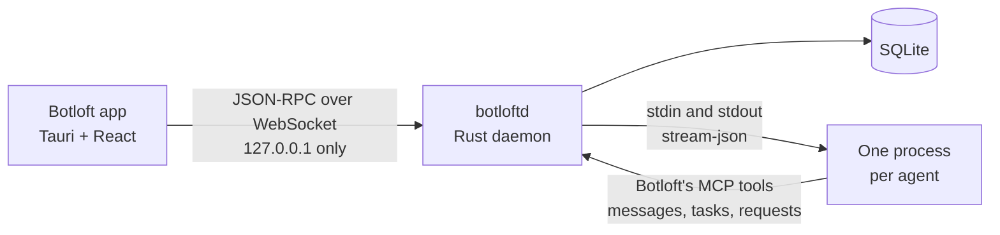

- **The daemon is the source of truth.** Closing the app never stops an agent. `botloftd` runs as a
  scheduled task of your Windows user, a systemd user service on Linux or a launch agent on macOS:
  it starts when you sign in and comes back soon if it dies.
- **Your engine is the runtime.** Each agent is a real session of the engine you chose (`claude -p`
  for Claude Code, `agy -p` for Antigravity and `codex app-server` for Codex) with its own
  workspace, memory and conversation. There is no custom agent SDK and no API key to manage.
- **One conversation per agent.** Your messages, messages from other agents and notices from the
  daemon reach the agent in order. What it does comes back as a chat: replies, tool use and
  requests you allow or deny.
- **Durable before delivered.** Every message is written to SQLite before it is sent and retried
  until it is delivered or marked as failed, which you can retry.

The full design, from the protocol to the states of an agent, lives in [`docs/spec.md`](docs/spec.md)
(in Portuguese).

## Privacy and security

- **Local first.** The daemon listens on `127.0.0.1`, and there is no telemetry. An account is
  optional. Without one, Botloft uses the network for nothing beyond updates and your agents' work:
  what they send to the engine's provider, which goes through the engine as when you use it
  yourself, and the websites and connected tools they use. With one, the server holds only backups
  sealed with a password that never leaves your computer, and passes along what a connected phone
  and your computer say to each other, sealed end to end (see the FAQ).
- **You decide what agents may do.** Per agent: ask before anything, accept edits, plan only, or
  decide on its own what needs your OK. Unless it decides on its own, an agent also asks before its
  first visit to each website.
- **Keys stay out of the chat.** The value of a key never goes into the chat, the database, backups
  or the cloud, and Botloft can find keys already pasted in a conversation and scrub them.
- **Tokens stay safe.** The app authenticates with an owner token readable only by your user
  account. Each agent gets its own token per start, and the daemon keeps only its SHA-256 hash.
- **Botloft is not a sandbox.** Every agent runs as your user account, so isolation between agents
  is cooperative: an agent can read other agents' folders if it decides to. Give agents only the
  permissions you would give that engine directly.

What Botloft sends over the network, what it changes on your computer and how to remove it are in
the [code signing policy](docs/code-signing-policy.md).

## FAQ

<details>
<summary><b>Does Botloft cost anything?</b></summary>

No. Botloft is free to use, at home or at work, and its source code is public (see
[License](#license)). The agents run on the engine you chose, with your own account, so they use
your plan's limits; with Claude Code, Botloft shows how much is left.
</details>

<details>
<summary><b>Do I need to keep the window open?</b></summary>

No. The agents run in the background, even after you close Botloft, and start when you sign in if
you want. Settings has a switch to stop them when you close the app instead.
</details>

<details>
<summary><b>Where are my agents and their files?</b></summary>

Each agent has a folder under `Botloft\<crew>\<agent>` in your home folder (`%USERPROFILE%` on
Windows, `~` on Linux and macOS), and each crew a shared work folder that you can point at a project
of yours. Botloft's own data (SQLite, logs, secrets) is in `%LOCALAPPDATA%\Botloft` on Windows,
`~/.local/share/Botloft` on Linux and `~/Library/Application Support/Botloft` on macOS.
</details>

<details>
<summary><b>What does the optional account keep, and who can read it?</b></summary>

You sign in with a link sent to your e-mail; there is no account password. The cloud copy is the
light one: your crews' structure, the agents' memory and the routines, not the chats or files.
Botloft seals it on your computer with the backup password before sending, so the server stores
bytes it cannot open. It also knows your e-mail, the computers you signed in on, the phones you
connected (and, if you turn on notices, where to send them), and the size and date of each copy.
Lose the backup password and the cloud copies cannot be recovered. Nothing is sent unless you send
it, turn on automatic copies or connect a phone. Automatic copies go every day or week, only when
something changed; for them Windows keeps your backup password in its credential store, on this
computer only, so use a password just for this. A connected phone talks to your computer through
the server, sealed end to end with keys only the two of them have: the server sees when and how much
passes, never what, and the notices it sends the phone are empty. You can delete the copies or the
whole account from the app, and disconnect a phone at any time. The server is this repository's
`botloft-cloud` crate: you can [run your own](docs/cloud-deploy.md) and point the app at it.
</details>

<details>
<summary><b>Why does Windows or macOS warn me when I install it?</b></summary>

The Windows installer is not code-signed yet, so SmartScreen does not know its publisher, and Apple
has not notarized the macOS app, so Gatekeeper blocks its first opening until you allow it. Each
release is built by GitHub Actions from this repository, and updates are signed and checked by the
app before they install. The [code signing policy](docs/code-signing-policy.md) says how releases
are made and how to check a download.
</details>

<details>
<summary><b>Does it run on macOS or Linux?</b></summary>

Yes, as a preview since 0.8.0: Linux (64-bit, `.deb` or AppImage) and macOS on Apple Silicon. Intel
Macs are not supported yet. Windows came first and has had the most use; if something does not work
elsewhere, please [open an issue](https://github.com/httpsphl/botloft/issues).
</details>

<details>
<summary><b>Is Botloft made by Anthropic?</b></summary>

No. Botloft is an independent project. It uses Claude Code, Antigravity and Codex as installed on
your computer and is not affiliated with or endorsed by Anthropic, Google or OpenAI.
</details>

## Status

Botloft is young (version 0.x) and moves fast: the latest release is
[0.20.0](https://github.com/httpsphl/botloft/releases/tag/v0.20.0) (2026-11-10), and the
[releases page](https://github.com/httpsphl/botloft/releases) says what each version brought. Still
open: a code-signed installer, and checking the phone page on an iPhone.

<details>
<summary><b>Development</b></summary>

Requirements: Rust stable (the MSVC toolchain on Windows), Node.js 24 and pnpm. On Linux, the app
also needs the desktop libraries Tauri uses (on Ubuntu: `libwebkit2gtk-4.1-dev`,
`libayatana-appindicator3-dev`, `librsvg2-dev`, `libxdo-dev`). Running real agents also needs an
engine installed and signed in: Claude Code (the native `claude` executable), Antigravity (`agy`)
or Codex.

```powershell
# Daemon and libraries
cargo build -p botloftd
cargo test --workspace
cargo clippy --workspace --all-targets -- -D warnings
cargo fmt --all --check

# Desktop app
cd app
pnpm install
pnpm tauri dev
pnpm dev          # the UI alone in a browser, with a fake daemon and sample crews
pnpm dev:site     # the public site, in the same way
pnpm check        # typecheck + Biome + Vitest
pnpm bundle       # this system's packages with the daemon inside: NSIS, .deb and AppImage, or .dmg
```

Set `BOTLOFT_HOME` to an absolute path such as `$PWD\.dev\home` during development so the daemon
never touches a real installation in `%LOCALAPPDATA%\Botloft`.

The daemon manages its own scheduled task (a systemd user service on Linux, a launch agent on
macOS):

```powershell
botloftd service install     # copy botloftd into the data folder, start it now and at every logon
botloftd service status
botloftd service restart
botloftd service uninstall   # stop it and remove the task; agents and data stay
```

Each data folder gets its own task, so a dev daemon installed with `BOTLOFT_HOME` (or `--home`)
never replaces the real one.

```
crates/botloft-core    domain types, IDs, message envelope, protocol types
crates/botloft-store   SQLite storage and migrations
crates/botloftd        the daemon
crates/botloft-cloud   the optional account server, the phone page and the public site
app/                   Tauri v2 + React desktop app, phone page and public site
docs/                  specification and ADRs
```
</details>

## Contributing

Contributions are welcome: bug reports, ideas, translations and code. Start with
[CONTRIBUTING.md](CONTRIBUTING.md); issues labeled
[`good first issue`](https://github.com/httpsphl/botloft/labels/good%20first%20issue) are a good
first step. Security problems go through [SECURITY.md](SECURITY.md), not public issues.

## License

Botloft is licensed under the [Functional Source License 1.1, Apache 2.0 future license](LICENSE)
(FSL-1.1-ALv2). In short:

- You may use Botloft for anything, including at work, read and change its code, and send
  contributions.
- You may not offer Botloft, or a copy or a change of it, as a commercial product or service that
  competes with it.
- Two years after each version is released, that version also becomes available under the
  [Apache License 2.0](https://www.apache.org/licenses/LICENSE-2.0).

Versions up to 0.9.1 were released under the Apache License 2.0 and stay under it. The
[LICENSE](LICENSE) file is what counts; this summary is not legal advice.

The mascot's gestures use [GSAP](https://gsap.com), which comes under its own
[Standard "no charge" License](https://gsap.com/standard-license), not the license above.

The icons of the tools on the Tools page (`app/src/assets/tools`) are the logos of their
services. They belong to their owners, are not covered by the license above, and are there only
to show which service each tool connects to.
